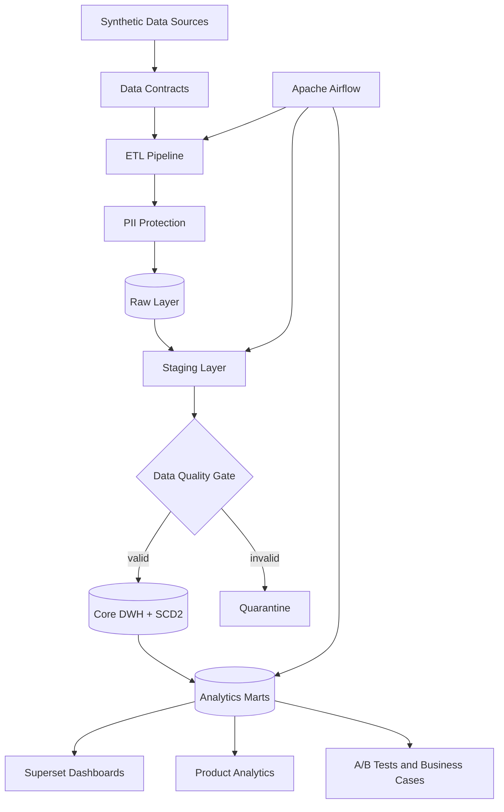

# Synthetic Product Analytics Platform

> Искусственная аналитическая платформа B2C SaaS-продукта, демонстрирующая полный цикл работы с данными: от генерации событий и построения DWH до продуктовой аналитики, A/B-тестов, BI-дашбордов и бизнес-решений.

Репозиторий моделирует пользователей, продуктовые события, подписки, платежи, маркетинг, эксперименты и инциденты. Все данные, эффекты экспериментов и бизнес-сценарии синтетические: проект показывает архитектуру и воспроизводимый код, но не описывает реальную компанию и не заявляет production SLA.

## Что демонстрирует проект

- Product Analytics: activation, funnel, retention, cohorts и продуктовые метрики;
- проектирование DWH со слоями Raw, Staging, Core и Analytics Marts;
- ETL/ELT-пайплайны с инкрементальной и идемпотентной загрузкой;
- orchestration в Apache Airflow;
- аналитическое MPP-хранилище Greenplum;
- Data Contracts, Data Quality gates и quarantine;
- защита PII с HMAC-SHA256, опциональным Fernet-шифрованием и RBAC;
- BI-дашборды в Apache Superset;
- A/B testing со статистическими проверками;
- Unit Economics: CAC, contribution LTV, LTV/CAC и payback.

## Архитектура



Основной локальный acceptance-flow использует SQLite и позволяет быстро проверить всю логику. Docker-профиль `full` запускает Airflow 2.10.5, Greenplum 7.1.0, Superset 4.1.1 и отдельные PostgreSQL metadata databases. SQL-модель ClickHouse сохранена как дополнительная реализация аналитических витрин.

## BI Dashboard

Все пять изображений ниже получены из работающего Superset, подключённого к Greenplum с детерминированными синтетическими данными.

### Executive Dashboard


Сводный экран с net revenue, active users и LTV/CAC по каналам привлечения.

### Retention Dashboard


Когортная таблица удержания по месяцу регистрации и acquisition channel с контрольными точками D1, D7, D30 и D90.

### Acquisition Dashboard


Сопоставляет регистрации, CAC, observed contribution LTV и LTV/CAC по каналам. Высокий объём привлечения рассматривается отдельно от качества когорты.

### Experiment Dashboard


Показывает размер выборки, checkout conversion и paid conversion по вариантам. Confidence intervals, SRM и guardrails рассчитываются в отдельном статистическом отчёте; дашборд не объявляет победителя автоматически.

### Incident Dashboard


Payment success rate в разрезе времени, платформы и версии приложения. Синтетический сценарий локализует ухудшение в Android 3.7.0.

Конфигурация BI находится в [`bi/superset`](bi/superset/README.md). Идемпотентный bootstrap создаёт подключение к Greenplum, 6 datasets, 10 charts и 5 dashboards.

## Data Architecture

### Raw

Слой принимает минимально преобразованные записи пользователей, событий, платежей, подписок, marketing spend и назначений в эксперименты. К каждой записи добавляются технические поля загрузки: источник, batch ID и время загрузки. Открытые имя, email, телефон и IP не загружаются в аналитическое хранилище: идентификаторы псевдонимизируются до записи в Raw.

### Staging

Здесь приводятся типы и регистр категорий, нормализуются значения, удаляются дубли по business key и исключаются невалидные строки. Записи, не прошедшие contracts, попадают в quarantine с безопасным идентификатором, причиной отклонения и отредактированным payload.

### Core DWH

Core — источник согласованных фактов и измерений:

| Объект | Grain / назначение |
|---|---|
| `dim_users` | один зарегистрированный пользователь |
| `dim_user_plan_history` | одна версия тарифа пользователя; SCD Type 2 |
| `dim_plans`, `dim_campaigns`, `dim_date` | справочные измерения |
| `fct_events` | одно продуктовое событие |
| `fct_payments` | одна попытка платежа или renewal |
| `fct_subscriptions` | один период действия подписки |
| `fct_experiments` | одно назначение пользователя в вариант эксперимента |

История тарифа хранится как SCD2 с полуоткрытыми интервалами `valid_from` / `valid_to` и флагом `is_current`. Это позволяет связывать активность и платежи с тарифом, действовавшим в момент события.

### Analytics Marts

SQL-модель содержит витрины для:

- ежедневных product и revenue-метрик;
- signup → activation → payment funnel;
- D1/D7/D30/D90 retention;
- acquisition и качества каналов;
- MRR movements и подписок;
- experiments и feature adoption;
- CAC, contribution LTV, LTV/CAC и payback;
- platform quality и состояния pipeline.

Определения grain, ключей и source of truth приведены в [`docs/DWH.md`](docs/DWH.md) и [`docs/METRICS.md`](docs/METRICS.md).

## ETL / ELT Pipeline

ETL используется до загрузки чувствительных данных: проверяет контракты, нормализует email и телефон, создаёт HMAC-идентификаторы, при необходимости шифрует PII и только затем пишет защищённые записи в Raw.

ELT выполняет объёмные преобразования внутри warehouse: Raw → Staging → Core → Analytics Marts. SQL остаётся рядом с хранилищем, поэтому логику метрик, partition pruning и поведение joins можно проверять по запросам и execution plans.

```text
Source
  ↓
Extract
  ↓
Validate ── invalid ──→ Quarantine
  ↓ valid
Protect PII
  ↓
Load Raw
  ↓
Transform in Warehouse
  ↓
Analytics Marts
```

Watermarks используют полуоткрытые UTC-интервалы. Batch metadata фиксирует время, диапазон, количество прочитанных, загруженных и отклонённых строк. Повторная обработка одного batch не создаёт дубликаты фактов.

## Apache Airflow

Airflow отвечает за расписание, зависимости, retries и наблюдаемое выполнение. Бизнес-логика остаётся в Python pipeline modules и SQL, а DAG содержит только orchestration.

| DAG | Расписание по умолчанию | Последовательность задач |
|---|---|---|
| `ingest_events` | каждый час | extract partitions → validate contracts → protect PII → incremental load |
| `ingest_billing` | каждый час в `:15` | extract billing → validate → protect PII → incremental load |
| `build_dwh` | manual trigger | Raw ready → Staging/Core → critical DQ gate |
| `build_analytics_marts` | ежедневно в 06:00 | incremental Core/Marts → DQ gate → publish |
| `data_quality` | каждый час в `:30` | contracts, integrity, freshness и volume checks |

Для interval-oriented DAG включён catchup, а `max_active_runs=1` защищает локальное хранилище от перекрывающихся записей. Schedules, retries и task timeout настраиваются через environment variables.

## Greenplum

Greenplum выбран как MPP warehouse для демонстрации распределённого выполнения аналитических запросов. Локальный Compose-контур содержит coordinator и два primary segments в одном контейнере; он показывает DDL и execution plans, но не моделирует multi-host fault tolerance и сетевую стоимость промышленного кластера.

### Distribution strategy

Крупные user-centered facts — events, payments и subscriptions — распределяются по `user_id`. Это колоцирует основные joins между фактами и `dim_users`. Небольшие стабильные dimensions (`dim_plans`, `dim_campaigns`, `dim_date`) реплицируются. Для контроля skew есть отдельные диагностические SQL-запросы.

### Partitioning

Events и payments разбиты на месячные RANGE partitions. Полуоткрытые фильтры по датам позволяют Greenplum исключать неиспользуемые partitions. Текущие границы DDL покрывают 2025–2026 годы и должны расширяться для данных за пределами этого периода.

### Optimization case

Один и тот же запрос был измерен на 3 000 000 synthetic events в Greenplum 7.1.0, по пять warm-cache запусков после прогрева:

| Вариант | Median execution time |
|---|---:|
| Before: full scan, random distribution, агрегация raw events | **107.077 ms** |
| After: partition pruning, `DISTRIBUTED BY (user_id)`, preaggregation | **10.908 ms** |
| Улучшение | **9.82×** / **89.8%** ниже |

В оптимизированном плане сканируется 1 из 24 partitions и отсутствует `Redistribute Motion`. Результат зависит от оборудования, cache state и конкретного запроса; полная методика и SQL находятся в [`benchmarks/results/greenplum_query_optimization.md`](benchmarks/results/greenplum_query_optimization.md).

## Data Quality

Проверки выполняются на границе источника и перед публикацией витрин:

- schema и data contract validation;
- обязательные поля, типы и допустимые enum-значения;
- uniqueness business keys;
- referential integrity между facts и dimensions;
- корректность временных интервалов и финансовых значений;
- freshness, volume, completeness и missing partitions;
- единственная текущая SCD2-запись на пользователя;
- синтетическая SLA telemetry.

```text
Bad data   → Quarantine → redacted payload + rejection reason
Valid data → Warehouse  → Core DQ gate → Analytics Marts
```

Критические ошибки — дубликаты ключей, orphan facts, отрицательные финансовые значения и некорректное состояние SCD2 — останавливают публикацию marts. Допустимые отклонения freshness/volume могут завершаться warning без скрытого изменения фактов.

## Security

### PII

Генератор создаёт только фиктивные PII: домен `example.test`, тестовый диапазон IP `192.0.2.0/24`, синтетические имена и номера 555. Чувствительными считаются имя, email, телефон и IP-адрес.

### HMAC

Email и телефон нормализуются, после чего идентификаторы псевдонимизируются HMAC-SHA256 с runtime-секретом `PII_HMAC_SECRET`. В отличие от обычного SHA-256, HMAC не позволяет заранее строить словари хешей без знания ключа.

### Encryption

Если аналитическому процессу действительно требуется обратимое хранение, полный PII-объект может быть зашифрован Fernet с аутентификацией. Без `PII_ENCRYPTION_KEY` открытые значения удаляются — это предпочтительный режим для аналитики.

### RBAC

В [`security/roles.sql`](security/roles.sql) определены роли:

- `admin` — управление всеми схемами;
- `analyst` — чтение Core и Marts без доступа к Raw;
- `bi_reader` — чтение только Analytics Marts;
- `etl_service` — запись в pipeline layers.

Analytics Marts не содержат raw PII. Тесты проверяют запрещённые колонки, редактирование quarantine payload и обработку шифрования/tampering. Пароли и ключи задаются через локальный `.env`, который исключён из Git.

## Product Analytics

### Retention

Удержание считается по точному возрасту когорты: D1, D7, D30 и D90. Незрелые когорты исключаются из соответствующих checkpoints, чтобы right censoring не выглядел как падение retention.

### Funnel

Базовая продуктовая последовательность:

```text
Signup → Activation → Payment
```

Activation определяется как завершённый onboarding и использование как минимум двух core features в течение трёх дней после регистрации. Funnel можно анализировать по дате, device/platform и app version.

### Cohorts

Когортная модель поддерживает разрезы по acquisition channel; данные Core и связанные витрины позволяют сопоставлять поведение по platform/device и plan. Финансовые показатели приводятся к synthetic daily USD FX перед агрегацией.

Словарь метрик, окна и владельцы показателей находятся в [`docs/METRICS.md`](docs/METRICS.md).

## A/B Testing

Experiment engine поддерживает:

- взаимоисключающее назначение control/treatment;
- absolute и relative uplift;
- confidence intervals и p-values;
- Sample Ratio Mismatch (SRM);
- primary, secondary, guardrail и exploratory metrics;
- Holm correction внутри заранее заданного семейства secondary metrics;
- bootstrap для revenue per assigned user в USD;
- изоляцию D30-эффектов и контроль утечки между экспериментами.

Низкий p-value не считается автоматическим решением. Интерпретация учитывает размер эффекта, ширину интервала, guardrails, зрелость окна наблюдения и assumptions по power/MDE. Проект не пишет «победитель эксперимента», если статистика этого не подтверждает.

## Business Cases

### Android Payment Incident

**Проблема:** payment success rate снизился в части Android-трафика.

**Анализ:** сравнение по platform и app version локализовало синтетический инцидент в Android 3.7.0: 12 успешных платежей из 31 попытки, success rate **38.71%**. Для исправленной версии 3.8.1 показатель составил **71.38%**; разница — **32.67 п.п.**

**Вывод:** блокировать 3.7.0 и контролировать fixed release. Это описательный результат синтетического сценария, а не доказательство причины реального инцидента.

### Pricing Experiment

Новый pricing-вариант показал trade-off: checkout conversion снизилась с **21.10%** до **18.64%**, а revenue per assigned user вырос с **$3.94** до **$4.31**. Point estimates недостаточно для rollout: решение должно учитывать bootstrap CI, SRM, refunds и зрелый D30 retention. Поэтому рекомендация отчёта — продолжать только как guarded experiment.

### Acquisition Analysis

Большое количество регистраций не означает качественный канал. В синтетическом запуске TikTok дал 2 511 регистраций, но observed contribution LTV/CAC **0.19**; Referral — 951 регистрацию и LTV/CAC **1.40**. Отчёт предлагает проверять дополнительный бюджет Referral, пока unit economics TikTok не улучшится. Observed LTV ограничен горизонтом данных, поэтому это не прогноз полного lifetime value.

Исходные отчёты находятся в [`business_cases`](business_cases/) и [`docs/business_cases`](docs/business_cases/).

## Запуск проекта

### Требования

- Python 3.11+;
- GNU Make для команд `make`;
- Docker Desktop / Docker Compose для полного стека.

### Локальная установка и тесты

```bash
make setup
make test
```

`make setup` создаёт `.venv`, устанавливает зависимости и проект в editable mode. Для небольшого воспроизводимого набора данных:

```bash
make generate-small
make quality
make warehouse
```

Полный локальный acceptance-flow, включая анализ экспериментов и генерацию business reports:

```bash
make acceptance
```

### Docker stack

Создайте локальный `.env` с автоматически сгенерированными секретами и запустите полный профиль:

```bash
make env
docker compose --profile full up -d
docker compose --profile full ps
```

После успешного health check доступны:

- Airflow UI — <http://localhost:8081>;
- Superset — <http://localhost:8088>;
- Greenplum — `localhost:5433`, database `synthetic_saas`.

Локальные credentials находятся только в ignored-файле `.env`. Остановить сервисы:

```bash
make down
```

Отдельные контуры запускаются командами `make airflow-up`, `make greenplum-up` и `make bi-up`.

## Результаты проверки

Финальная проверка выполнена на clean clone текущего commit:

```text
Pytest:      37 tests passed
Ruff:        passed
Clean clone: make setup + make test passed
Docker:      Airflow, Greenplum and Superset healthy
```

Greenplum был заполнен demo data, Superset bootstrap создал 5 dashboards, а Airflow зарегистрировал 5 DAG без изменения бизнес-логики pipeline modules.

## Структура проекта

```text
.
├── airflow/
│   └── dags/                 # DAG и orchestration
├── analysis/                 # A/B tests и анализ сценариев
├── benchmarks/
│   ├── greenplum/            # воспроизводимый MPP benchmark
│   └── results/              # зафиксированные результаты
├── bi/superset/              # BI specification и bootstrap
├── business_cases/           # сгенерированные аналитические отчёты
├── config/                   # generation и business rules
├── contracts/                # JSON contracts и relationship tests
├── docker/greenplum-init/    # demo marts и данные для Docker
├── docs/                     # архитектура, метрики и learning path
│   └── images/               # реальные Superset screenshots
├── security/                 # Greenplum RBAC
├── sql/
│   └── greenplum/            # DDL, distribution и partitioning
├── src/saasgen/              # generator, DQ, security и warehouse pipeline
├── tests/                    # unit, regression и integration tests
├── validation/               # validation runner
├── compose.yaml
├── Makefile
└── README.md
```

## Learning Path

Проект можно изучать последовательно:

1. Data generation;
2. Data Contracts;
3. ETL;
4. DWH;
5. Greenplum;
6. Airflow;
7. Data Quality;
8. Security;
9. BI;
10. Product Analytics.

Пошаговый маршрут с командами, файлами и ожидаемыми результатами: [`docs/LEARNING_PATH.md`](docs/LEARNING_PATH.md).

## Документация

- [Architecture](docs/ARCHITECTURE.md) и [Data Flow](docs/DATA_FLOW.md)
- [DWH](docs/DWH.md) и [ETL/ELT](docs/ETL_ELT.md)
- [Airflow](docs/AIRFLOW.md) и [Greenplum](docs/GREENPLUM.md)
- [Data Quality](docs/DATA_QUALITY.md) и [Security](docs/SECURITY.md)
- [BI](docs/BI.md), [Metrics](docs/METRICS.md) и [Experiments](docs/EXPERIMENTS.md)
- [Business Cases](docs/BUSINESS_CASES.md) и [Performance](docs/PERFORMANCE.md)

## Ограничения

- Синтетические причинно-подобные зависимости не являются causal proof.
- Single-host Greenplum profile предназначен для обучения и проверки SQL/MPP-планов, а не для capacity planning.
- Результат benchmark зависит от среды, cache state и запроса.
- Superset bootstrap привязан к зафиксированной версии 4.1.1; upgrade может потребовать migration.
- KMS, автоматическая rotation secrets, HA, backups, network policy и операционный on-call находятся за рамками репозитория.

Подробные подтверждения реализации собраны в [`IMPLEMENTATION_REPORT.md`](IMPLEMENTATION_REPORT.md), а проверка перед публичной публикацией — в [`SECURITY_REVIEW.md`](SECURITY_REVIEW.md).
