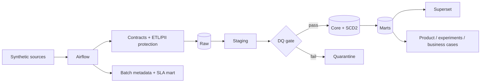
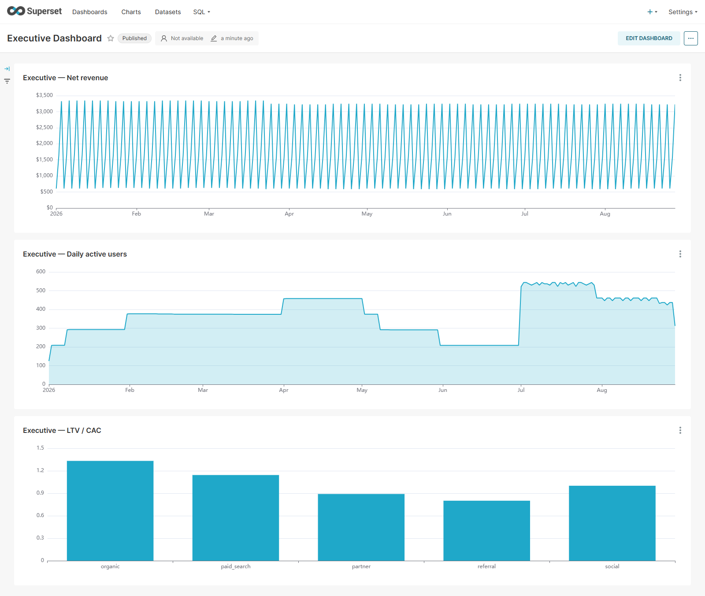
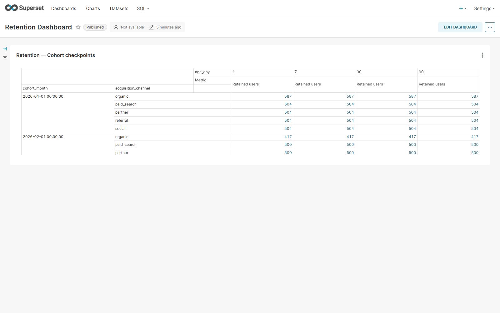
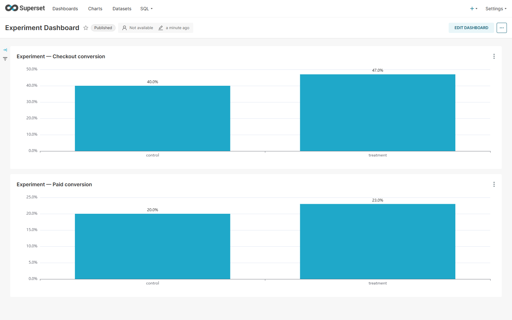
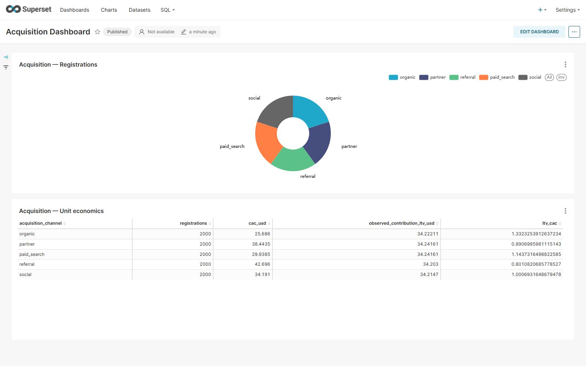
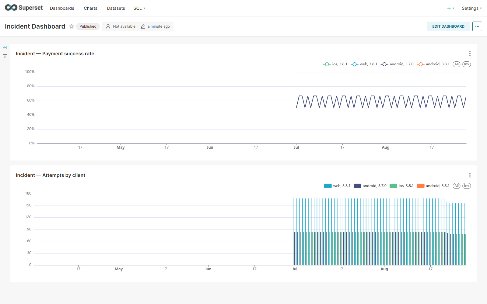

# Synthetic Product Analytics Platform

> A fully synthetic, locally runnable analytics-engineering portfolio project. It demonstrates architecture and code; it is not a real company's production system and makes no production-scale or SLA claims.

## Business problem

The modeled B2C SaaS product has acquisition channels, registration/onboarding, web/iOS/Android events, subscriptions, payments, experiments, FX, planned releases, data-quality defects, and a synthetic Android payment incident. The repository connects generated business behavior to secure ingestion, a DWH, product metrics, experiments, unit economics, BI specifications, and decision reports.

## Architecture



The executable default uses SQLite for fast tests. An optional Greenplum 7 profile contains real MPP DDL, `user_id` distribution, replicated dimensions, monthly partitions, skew diagnostics, and an optimization benchmark. Existing ClickHouse SQL is retained.

## What is implemented

- deterministic small/medium/large chunked PyArrow/Parquet generation;
- raw/clean/quarantine source layers and JSON contracts;
- incremental, idempotent ETL/ELT with watermarks and batch metadata;
- raw/staging/core/marts DWH plus plan SCD Type 2;
- synthetic PII, email/phone normalization, HMAC-SHA256 pseudonyms, optional Fernet encryption, redacted rejects, and RBAC;
- Airflow DAGs for event/billing ingestion, DWH, marts, and DQ;
- contract, uniqueness, null, referential, freshness, volume, finance, and SLA checks with a hard mart gate;
- historical MRR movement, retention, activation, CAC, contribution LTV/payback, experiments, and Android incident analysis;
- Superset Compose service, idempotent provisioning, five rendered dashboards, and real screenshots;
- CI, integration tests, security review, benchmarks, business reports, and a guided learning path.

## Data model

Core dimensions: users, plans, campaigns, date, and user plan history. Core facts: events, payments, subscriptions, and experiment assignments. The original ClickHouse model provides ten detailed analytical marts; the portable integration path builds product daily, revenue daily, and pipeline health. Grain, keys, and SCD2 behavior are documented in [DWH](docs/DWH.md).

## Quick start

Python 3.11+:

```bash
python -m venv .venv
# Windows: .venv\Scripts\activate
# macOS/Linux: source .venv/bin/activate
pip install -r requirements.txt
pip install -e .
python generate.py --users 1000 --target-events 30000 --seed 42 --output data/demo --inject-data-quality-issues false
python quality.py --input data/demo --layer clean
```

Set a local-only secret and build the lightweight warehouse:

```bash
# PowerShell
$env:PII_HMAC_SECRET="replace-with-a-local-secret-at-least-16-bytes"
python warehouse.py --input data/demo --database data/demo.db

# bash
export PII_HMAC_SECRET="replace-with-a-local-secret-at-least-16-bytes"
python warehouse.py --input data/demo --database data/demo.db
```

Run tests: `python -m pytest -q`. Run the compact full acceptance flow: `make acceptance` (on Windows, execute the individual commands from the Makefile if `make` is unavailable).

## Optional infrastructure

Generate an untracked local `.env` and start the complete stack:

```bash
python scripts/bootstrap_env.py
docker compose --profile full up -d
docker compose --profile full ps
```

Open Airflow at [localhost:8081](http://localhost:8081), Superset at
[localhost:8088](http://localhost:8088), and connect to Greenplum on
`localhost:5433`. Local admin credentials are generated into `.env` and are
never committed. The full stack was cold-started, health-checked, restarted,
and used to produce the screenshots below.

## Superset dashboards

| Executive | Retention |
|---|---|
|  |  |
| Experiment | Acquisition |
|  |  |



The dashboards query real Greenplum marts populated with deterministic
synthetic demo data. Recreate them with `python scripts/capture_superset.py`
after starting the stack.

## Experiments and business decisions

The statistical engine preserves mutually exclusive enrollment, SRM, confidence intervals, scoped Holm correction, bootstrap USD revenue, guardrails, and no-leakage D30 effects. Business cases cover the Android incident, pricing trade-off, acquisition quality, onboarding, and retention. All effects and recommendations are synthetic and run-dependent.

## Repository map

```text
src/saasgen/             generator, DQ, security, warehouse pipeline
contracts/               source contracts and relationship tests
sql/greenplum/           MPP DDL, distribution, partitions, optimization
sql/                     retained ClickHouse staging/core/marts
airflow/                 thin DAGs and orchestration notes
bi/superset/             dashboard specification
docker/greenplum-init/   deterministic local demo data and marts
analysis/                experiment and business-pattern analysis
business_cases/          generated analytical reports
benchmarks/              reproducible generator and Greenplum measurements
tests/                   unit, regression, SQL, security, integration tests
docs/                    architecture, operations, metrics, screenshots
```

## Documentation

[Architecture](docs/ARCHITECTURE.md) · [Data flow](docs/DATA_FLOW.md) · [DWH](docs/DWH.md) · [ETL/ELT](docs/ETL_ELT.md) · [Airflow](docs/AIRFLOW.md) · [Greenplum](docs/GREENPLUM.md) · [Data quality](docs/DATA_QUALITY.md) · [Security](docs/SECURITY.md) · [BI](docs/BI.md) · [Metrics](docs/METRICS.md) · [Experiments](docs/EXPERIMENTS.md) · [Performance](docs/PERFORMANCE.md) · [Business cases](docs/BUSINESS_CASES.md) · [Learning path](docs/LEARNING_PATH.md)

## Limitations

- Synthetic causal-like behavior is not causal truth or observed business impact.
- SQLite proves portable logic; the two-segment, single-host Greenplum Compose profile remains educational rather than a production capacity model.
- The measured Greenplum result is hardware/cache/query specific; see the full methodology in [the benchmark report](benchmarks/results/greenplum_query_optimization.md).
- Superset dashboards are provisioned for the pinned 4.1.1 image; upgrades can require visualization or metadata migration.
- Secrets/KMS, HA, backups, network policy, and on-call operations are designs rather than deployed services.

See [IMPLEMENTATION_REPORT.md](IMPLEMENTATION_REPORT.md) for verified evidence and [SECURITY_REVIEW.md](SECURITY_REVIEW.md) for the publication review.
