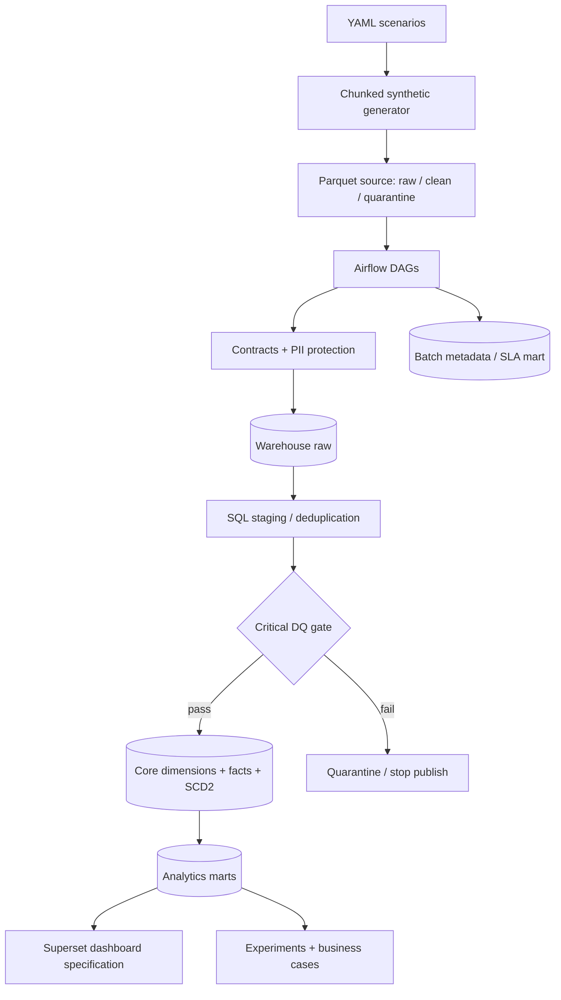

# Architecture

## What and why

This repository demonstrates a complete analytical lifecycle using synthetic data. It is an executable learning/portfolio system, not a claim about a company's production deployment.

## Implemented paths

- Default executable path: Parquet → `saasgen.warehouse` → SQLite raw/staging/core/marts. It supports incremental watermarks, idempotent upserts, quarantine, SCD2, DQ gating, and integration tests.
- MPP path: the same logical model is expressed as Greenplum SQL with `DISTRIBUTED BY`, replicated small dimensions, append-optimized facts, monthly partitions, and diagnostics.
- Retained path: existing ClickHouse DDL/marts remain available; they were not removed or silently rewritten.
- Orchestration: five Airflow DAGs are thin wrappers around Python and SQL components.
- BI: Compose deploys Superset, provisions five dashboard groups, and includes screenshots captured from the running service.

## Trade-offs and verification

SQLite has no MPP distribution or schema namespaces, so it uses table prefixes/views and is only the portable test fallback. Greenplum is the authoritative MPP design. Run `pytest -q` for the lightweight lifecycle, `make greenplum-up` for the optional cluster, and inspect the plans under `sql/greenplum/optimization` for MPP behavior.
